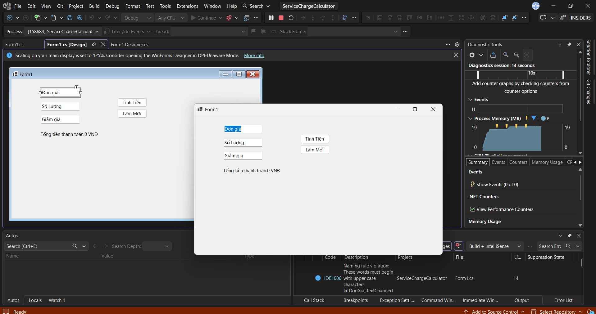
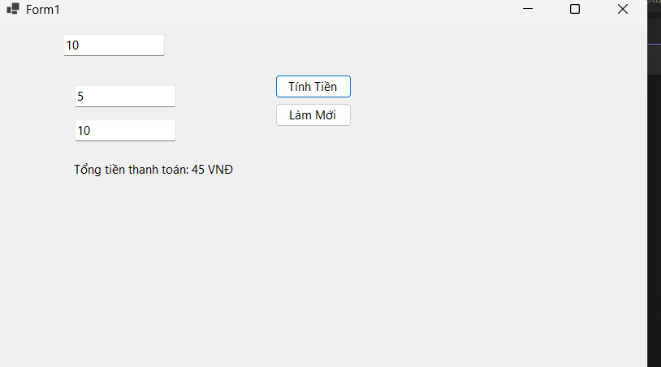
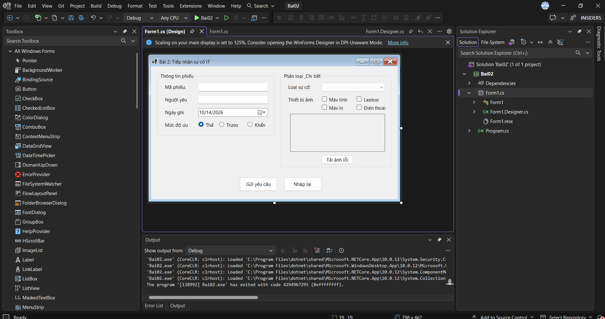
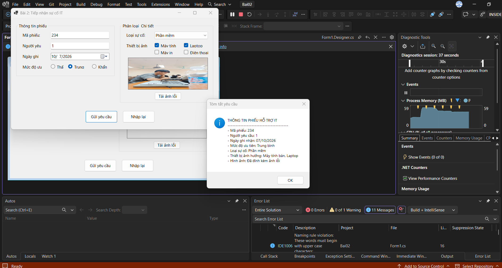
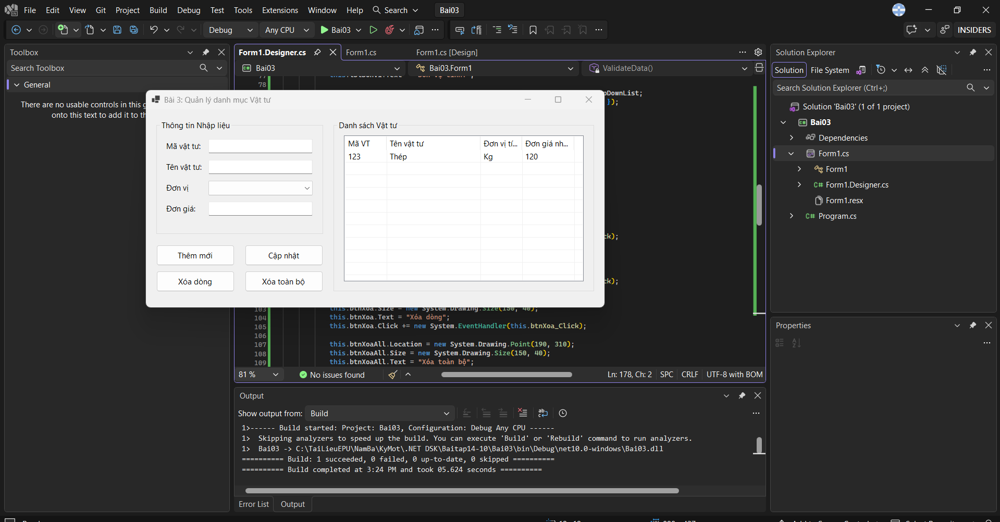
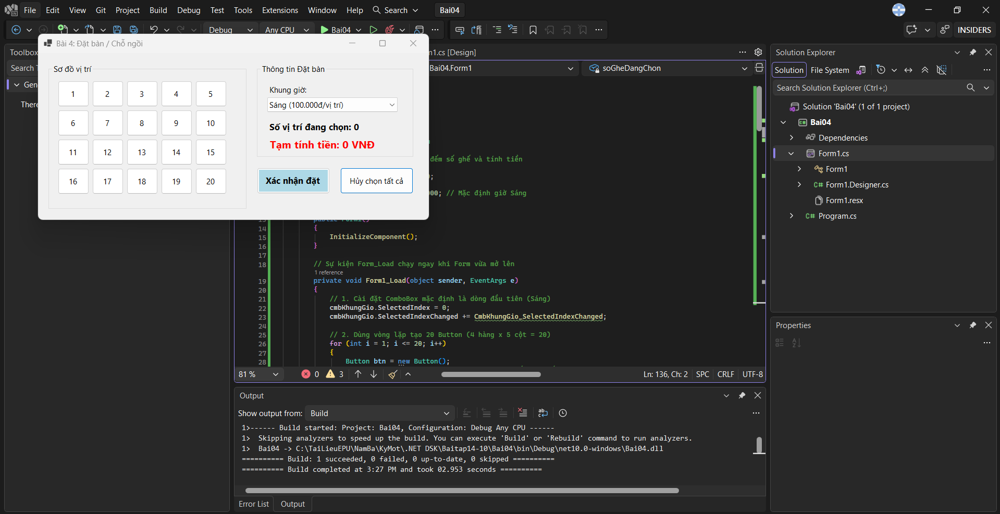
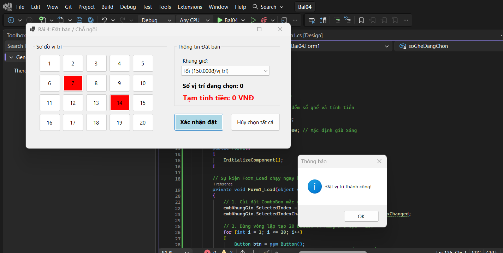
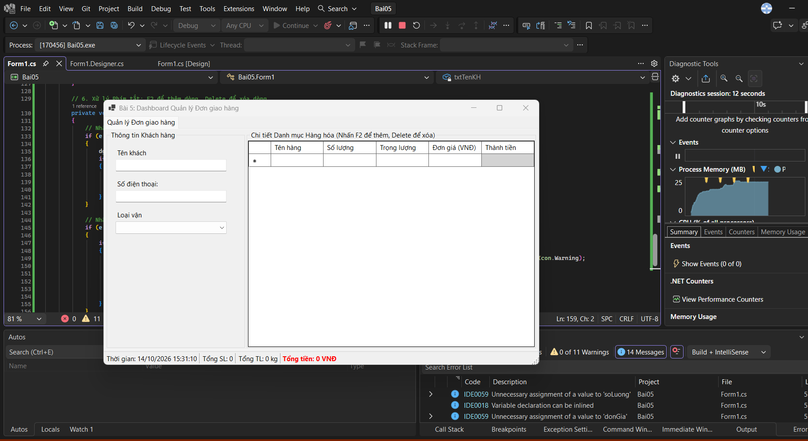
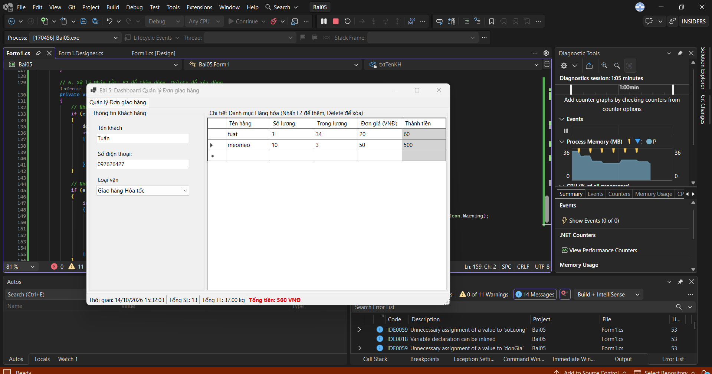

# BÁO CÁO THỰC HÀNH C# WINFORMS

## THÔNG TIN SINH VIÊN
- **Họ và tên:** Nguyễn Trường Giang
- **Mã số sinh viên:** 24810310200
- **Lớp:** D19CNPM3
- **Tên môn học:** Lập trình .NET
- **Nội dung:** bài tập thực hành 14-10

---

## KẾT QUẢ THỰC HÀNH

### BÀI 1: MÁY TÍNH CƯỚC DỊCH VỤ & GIẢM GIÁ
**1. Giao diện chính**

**2. Kết quả tính toán**

**3. Kiểm tra lỗi (Validation)**

---

### BÀI 2: FORM TIẾP NHẬN SỰ CỐ IT
**1. Giao diện nhập liệu**

**2. Bảng tóm tắt thông tin gửi đi**

---

### BÀI 3: QUẢN LÝ DANH MỤC VẬT TƯ
**1. Giao diện ListView**

**2. Thêm / Sửa / Xóa dữ liệu**

---

### BÀI 4: SƠ ĐỒ CHỌN CHỖ NGỒI (ĐẶT BÀN)
**1. Giao diện sinh tự động bằng Code**

**2. Tính tiền và Xác nhận chỗ**

---

### BÀI 5: DASHBOARD QUẢN LÝ ĐƠN GIAO HÀNG
**1. Giao diện SplitContainer đa tầng**

**2. Tự động tính toán DataGridView & StatusStrip**

